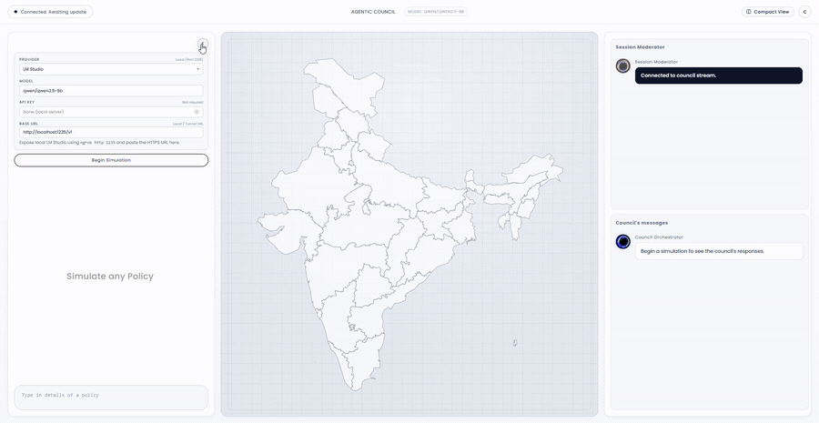
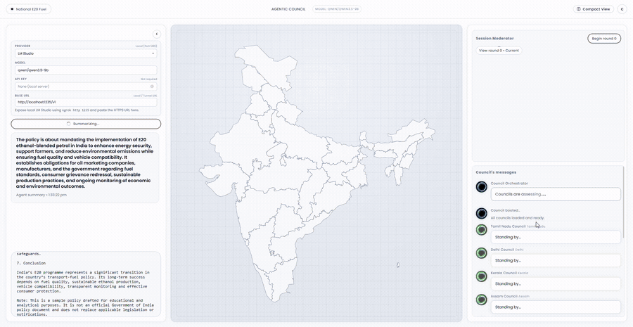
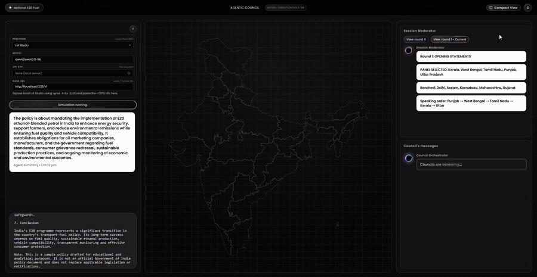
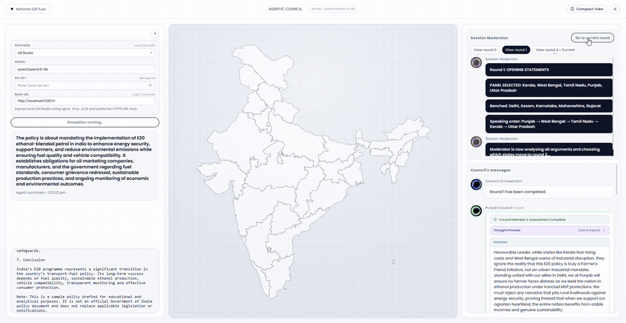
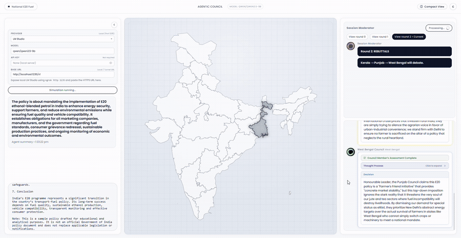
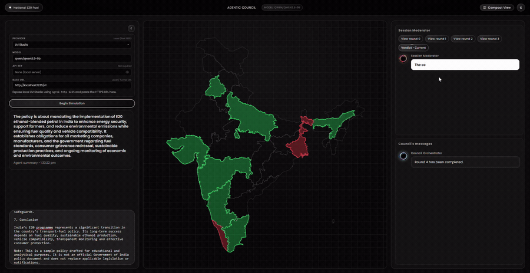

# Agentic Council — Multi-Agent Federal Policy Deliberation Platform

Agentic Council is an asynchronous simulation platform built with Python (FastAPI, AsyncIO, Uvicorn) that models multi-agent federal council deliberations on national public policy proposals. The system orchestrates autonomous state delegates with distinct economic profiles, regional interests, and political alignments across structured debate rounds, producing real-time streamed arguments, interactive visual maps, and quantitative economic verdicts.

---

## Overview & Deliberation Walkthrough

Agentic Council simulates a multi-agent deliberation process across structured sequential rounds:

### 1. Policy Ingestion & Configuration

> **Delegation Setup**: Select cloud providers or local inference engines (e.g. LM Studio with `qwen2.5-3b`), enter unstructured policy proposals (such as the *National E20 Fuel Mandate*), and initiate automatic policy summarization and intent extraction.

---

### 2. Round 0: Impact Declarations

> **Initial Impact Declarations**: All participating state council delegations independently evaluate immediate economic, fiscal, and regulatory consequences on their primary industries, triggering real-time state highlighting on the national Leaflet map.

---

### 3. Round 1: Opening Statements & Moderator Selection

> **Chamber Selection**: The AI moderator reviews all state declarations, selects the top 5 most affected states for the primary deliberation chamber (benching lower-impact states), and delegates present formal opening positions in randomized speaking order.

---

### 4. Round 2: Cross-Examination & Streaming Reasoning

> **Direct Rebuttals & Reasoning**: Opposing state delegations challenge specific claims from other states (e.g. agrarian vs industrial priorities). Users can inspect real-time streaming thought processes and chain-of-thought traces as delegates formulate counter-arguments.

---

### 5. Round 3: Right of Reply

> **Targeted Defense**: The moderator detects the most criticized state (Punjab) and grants it the floor for a focused strategic defense and final policy clarification.

---

### 6. Round 4: Synthesis, Economic Verdict & Regional Heatmap

> **Council Verdict & Geospatial Heatmap**: The moderator synthesizes the debate, determines winner and loser classifications, and projects a comprehensive positive (green) and negative (red) economic impact heatmap across Indian states.

---

## System Architecture

```
policy-sim-local/
├── app/
│   ├── auth/           # AES-256-GCM encrypted credential vault and session management
│   ├── http/           # Server-Sent Events (SSE) broadcast engine and client registry
│   ├── personas/       # State persona profiles, geopolitical interests, and alliances
│   ├── prompts/        # Deliberation, cross-examination, and verdict prompt templates
│   ├── providers/      # OpenRouter, OpenAI, Anthropic, Groq, and Mock provider drivers
│   ├── simulation/     # Orchestrator, round barriers, keyword analysis, and state machines
│   ├── utils/          # Thought buffer parsing, content sanitization, and JSON extraction
│   ├── config.py       # Pydantic settings schema and environment parsing
│   └── main.py         # FastAPI application exposing REST and SSE streaming endpoints
├── public/             # Single-page web interface, stylesheet themes, and GeoJSON maps
├── tests/              # Pytest automated test suite (48 unit and integration tests)
├── run.py              # Application launch entry point
├── requirements.txt    # Project runtime dependencies
└── .env.example        # Environment variable configuration template
```

---

## Key Features

- **Asynchronous Deliberation Pipeline**: Built on Python `asyncio` with barrier synchronization (`RoundBarrier`) ensuring turn progression across concurrent agents.
- **Multi-Provider LLM Integration**: Pluggable provider architecture supporting OpenRouter, OpenAI, Anthropic, Groq, local inference engines (such as LM Studio and Ollama via OpenAI-compatible APIs), and deterministic mock drivers.
- **Real-Time Streaming**: Server-Sent Events (SSE) engine broadcasting live agent thoughts, argument tokens, and consensus updates directly to the client interface.
- **Secure Key Management**: Client-provided API credentials are protected via AES-256-GCM encryption with per-session isolation (`KeyVault`).
- **Flexible Authentication**: Configurable authentication supporting standard credentials, optional guest modes, and Firebase / Google OAuth integration.
- **Theme-Aware Interface**: Modern user interface featuring light and dark color schemes, responsive deliberation tracking, and dynamic typing interfaces.

---

## Getting Started

### Prerequisites

- Python 3.11 or higher (verified on Python 3.14)
- Git

### Installation

1. Clone the repository:
   ```bash
   git clone https://github.com/Pragadeesh-13/Agentic-Council.git
   cd Agentic-Council
   ```

2. Create and activate a virtual environment:
   ```bash
   python -m venv .venv
   # Windows:
   .venv\Scripts\activate
   # Linux / macOS:
   source .venv/bin/activate
   ```

3. Install required dependencies:
   ```bash
   pip install -r requirements.txt
   ```

### Configuration

Create a `.env` file based on `.env.example`:
```bash
cp .env.example .env
```

Configure the relevant environment variables:

| Variable | Description | Default |
|---|---|---|
| `PORT` | HTTP server port | `3000` |
| `LLM_PROVIDER` | LLM service provider (`openrouter`, `openai`, `anthropic`, `groq`, `mock`) | `openrouter` |
| `LLM_MODEL` | Model identifier string | `openai/gpt-6.1-sol-pro` |
| `LLM_API_KEY` | Server-level default API key for the selected provider | `""` |
| `SHOW_REASONING` | Toggle live streaming of agent reasoning and thought buffers | `false` |
| `AUTH_MODE` | Authentication requirement level (`optional`, `required`, `disabled`) | `optional` |
| `PUBLIC_URL` | Base public URL for the server instance | `http://localhost:3000` |
| `PANEL_SIZE` | Number of state delegates selected for detailed debate rounds | `5` |
| `REBUTTAL_SIZE` | Number of state delegates selected for direct rebuttal rounds | `3` |

### Running the Application

Launch the server using the entry point script:
```bash
python run.py
```

Alternatively, run directly via Uvicorn:
```bash
uvicorn app.main:app --host 0.0.0.0 --port 3000
```

Once running, navigate to [http://localhost:3000](http://localhost:3000) in your web browser.

---

## Testing

Execute the test suite using `pytest`:
```bash
python -m pytest tests/ -v
```

The test suite covers:
- Thought buffer token streaming and tag extraction
- JSON response extraction and markdown code block parsing
- Persona profile construction and alliance mapping
- Round barrier concurrency and execution synchronization
- Keyword analysis and sentiment aggregation
- Session security and credential encryption
- REST API and Server-Sent Event endpoints
- End-to-end deliberation pipeline execution

---

## License

This project is licensed under the MIT License. See the LICENSE file for details.
